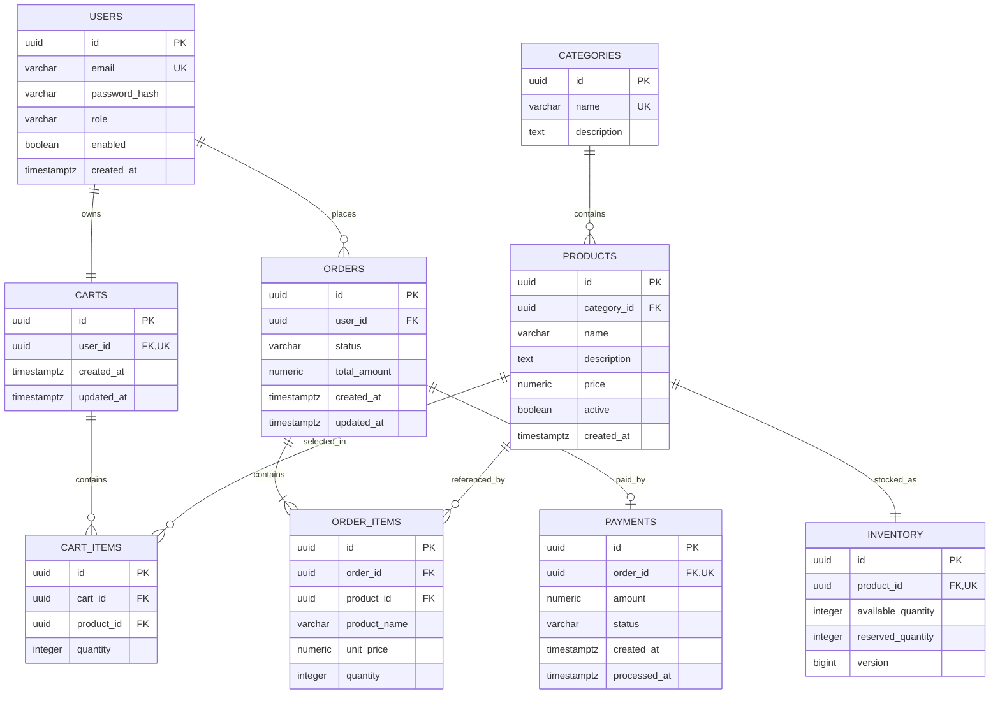

# OrderFlow — модель данных MVP
Версия: 1.0 (проектное предложение, 15.11.2026)

## Ограничения
- UUID для ключей; деньги `NUMERIC(19,2)`/`BigDecimal`; время `TIMESTAMPTZ`/`Instant`.
- `users.email` уникален без учёта регистра (нормализованный email или функциональный индекс).
- `inventory.product_id`, `carts.user_id`, `payments.order_id` уникальны.
- `cart_items(cart_id, product_id)` уникален.
- `price > 0`, `quantity > 0`, `available_quantity >= 0`, `reserved_quantity >= 0`, `total_amount >= 0`, `amount >= 0`.
- `order_items` содержит snapshot названия и цены; `product_id` — ссылка на исходный товар, физическое удаление товара после заказов запрещено.
- `inventory.available_quantity` — доступное для нового резерва количество, `reserved_quantity` — зарезервированное; при резерве available -= q, reserved += q.
- Версия MVP: одна попытка оплаты на заказ, поэтому `payments.order_id` уникален. Для повторных попыток позже понадобится `payment_attempts`.
- В таблицах допускаются дополнительные индексы по `orders(user_id,created_at)`, `products(category_id,active)`.

## Замечания к реализации
Связи на ER-диаграмме не означают необходимость двунаправленных JPA-ассоциаций. Межмодульные ссылки предпочтительно хранить как UUID и использовать DTO. Удаление корзины после оформления не требуется: очищаются позиции.
